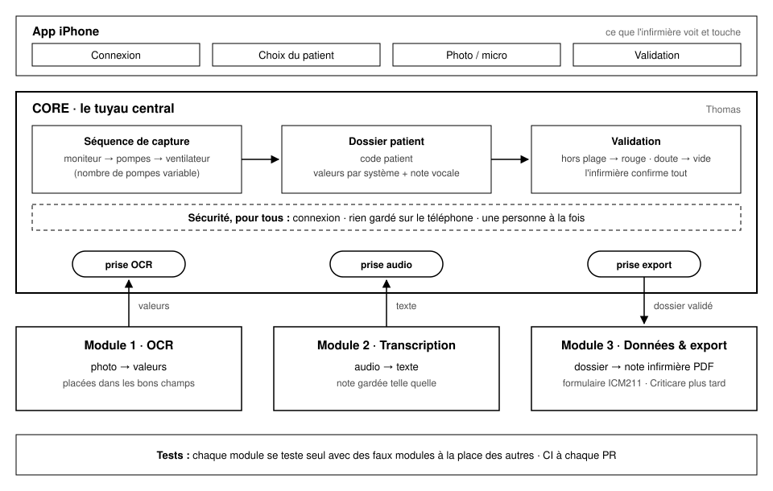

# Capture ICU

App iPhone pour les soins intensifs de l'Institut de Cardiologie de Montréal.
L'infirmière photographie les appareils au chevet, dicte sa note, vérifie les
valeurs, et obtient sa note infirmière en PDF.

Projet intégrateur GBM8970, Polytechnique Montréal.



## Par où commencer

1. **[docs/ARCHITECTURE.md](docs/ARCHITECTURE.md)** : comment les pièces s'emboîtent (5 minutes).
2. **Le LISEZ-MOI de votre module** : [OCR](Modules/OCR/LISEZ-MOI.md),
   [Transcription](Modules/Transcription/LISEZ-MOI.md) ou [Export](Modules/Export/LISEZ-MOI.md).
3. **[docs/GUIDE-EQUIPE.md](docs/GUIDE-EQUIPE.md)** : ouvrir le projet, lancer les tests,
   écrire un test, proposer son code.

## Qui travaille où

| Dossier | Ce qu'il fait | Responsable |
|---|---|---|
| `Core/` | le tuyau central : parcours, dossier, validation, les 3 prises | Thomas |
| `Modules/OCR/` | photo → valeurs | *à nommer* |
| `Modules/Transcription/` | audio → texte de la note | *à nommer* |
| `Modules/Export/` | dossier validé → note infirmière PDF | *à nommer* |
| `App/` | les écrans iPhone | *à nommer* |
| `OutilsDeTest/` | faux modules et vérification des prises | Thomas |
| `BoutEnBout/` | le test du parcours complet | toute l'équipe |

## Les deux commandes à retenir

```bash
bash scripts/tester.sh ocr     # les tests de votre module (ocr, transcription, export, core)
bash scripts/verifier.sh       # tout, avant d'ouvrir une pull request
```

## Où on en est

**Squelette qui marche :** tout le parcours fonctionne de bout en bout
(connexion, patient, photos, note, validation, PDF), avec des valeurs factices.
Chaque équipe remplace maintenant les valeurs factices de son module par le
vrai traitement, sans toucher au reste.

**Aucune vraie donnée patient dans ce dépôt, jamais.** Ni photo, ni audio, ni nom.
