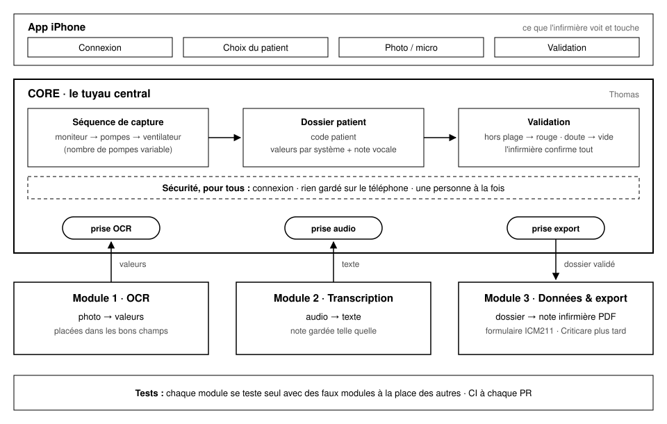

# L'architecture en 5 minutes



## L'idée

Un **Core** au centre, qui fait passer le dossier du patient d'une étape à
l'autre. Trois **modules** s'y branchent, chacun par sa **prise**. Une prise
dit ce que le module reçoit, ce qu'il rend et ce qui arrive en cas d'erreur.

Tant que votre module respecte sa prise, vous changez ce que vous voulez à
l'intérieur sans rien casser chez les autres.

## Le parcours de l'infirmière

| Étape | Ce qui se passe | Qui travaille |
|---|---|---|
| 1. Connexion | identifiant + mot de passe (factice : `demo` / `demo`) | Core |
| 2. Choix du patient | un code, jamais un nom (`P-001`) | Core |
| 3. Photos | l'app demande les appareils dans l'ordre : moniteur, pompes, ventilateur | Core → **module OCR** |
| 4. Note vocale | l'infirmière dicte, le texte est gardé mot pour mot | Core → **module Transcription** |
| 5. Validation | hors plage → rouge; illisible → case vide à remplir; l'infirmière confirme | Core |
| 6. Note infirmière | le dossier validé devient un PDF | Core → **module Export** |

## Les trois prises

Elles sont dans `Core/Code/Prises/`. Chacune tient en une ligne de code :

| Module | Prise | Reçoit | Rend |
|---|---|---|---|
| OCR | `PriseOCR` | une `Photo` et l'`Appareil` photographié | des `Mesure` (paramètre, valeur, confiance) |
| Transcription | `PriseTranscription` | un `Audio` | le texte de la note |
| Export | `PriseExport` | un `Dossier` validé | un `DocumentExporte` (le PDF) |

## Où est quoi

```
capture-icu/
├── Package.swift              la carte du projet (qui dépend de qui)
├── Core/                      LE TUYAU CENTRAL (Thomas)
│   ├── Code/Prises/           les 3 prises
│   ├── Code/Modeles/          Patient, Appareil, Parametre, Mesure, Dossier
│   ├── Code/Tuyau/            SessionDeCapture : le parcours, étape par étape
│   └── Tests/                 un fichier de tests par étape du parcours
├── Modules/
│   ├── OCR/                   Code/ + Tests/ + LISEZ-MOI.md
│   ├── Transcription/         Code/ + Tests/ + LISEZ-MOI.md
│   └── Export/                Code/ + Tests/ + LISEZ-MOI.md
├── OutilsDeTest/              faux modules, exemples, vérification des prises
├── BoutEnBout/                un test qui fait tout le parcours avec les vrais modules
├── App/                       les écrans iPhone (SwiftUI)
├── docs/                      ce fichier, le guide de l'équipe, les exigences
└── scripts/                   verifier.sh, tester.sh, tracabilite.sh
```

## Les faux modules

Les tests du Core n'utilisent pas vos modules : ils utilisent des **faux**
(`OutilsDeTest/FauxModules.swift`). Par exemple, `FauxOCR` rend toujours
« FC 88 », sans regarder la photo.

Ça permet deux choses :

- tester le Core sans attendre que l'OCR marche;
- tester un cas précis facilement : `FauxOCR([.moniteur: [Mesure(.frequenceCardiaque, valeur: 300)]])`
  sert à vérifier que la valeur 300 s'affiche en rouge.

Les faux et les vrais modules passent **la même vérification de prise**
(`OutilsDeTest/VerifierLesPrises.swift`). C'est ce qui garantit qu'un test écrit
avec un faux reste vrai avec le vrai.

## Les quatre règles

1. **Le Core ne connaît pas l'iPhone.** Pas de `SwiftUI`, `UIKit`, `Vision` ni
   `Speech` dans `Core/` : c'est ce qui permet de tout tester sur un ordinateur
   ordinaire. `scripts/verifier.sh` le vérifie.
2. **Les modules ne se parlent pas entre eux.** L'OCR ne connaît pas l'export.
   Tout passe par le Core.
3. **Une prise ne change pas sans accord.** La modifier touche toute l'équipe :
   ouvrir une *issue* d'abord (voir `GUIDE-EQUIPE.md`).
4. **Aucune vraie donnée patient dans le dépôt.** Pas de photo, d'audio, de nom
   ni de numéro de dossier. Le dépôt peut être public.

## Ce qui viendra plus tard

La vraie connexion sécurisée, l'accès aux vraies listes de patients, la note
médicale et l'envoi vers Criticare. Le squelette est construit pour que ces
ajouts se branchent sans tout refaire.
